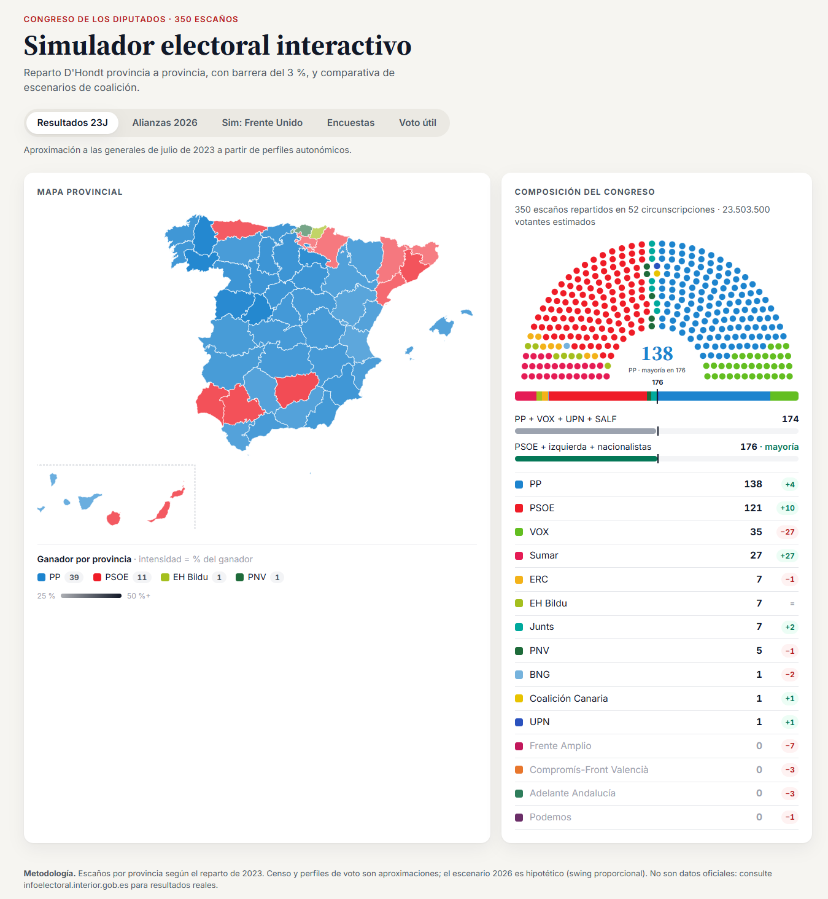
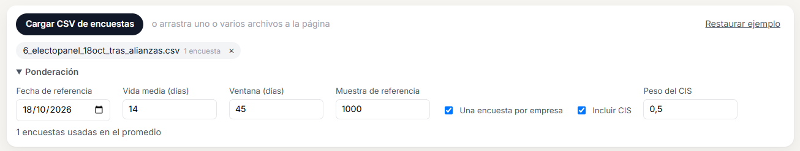
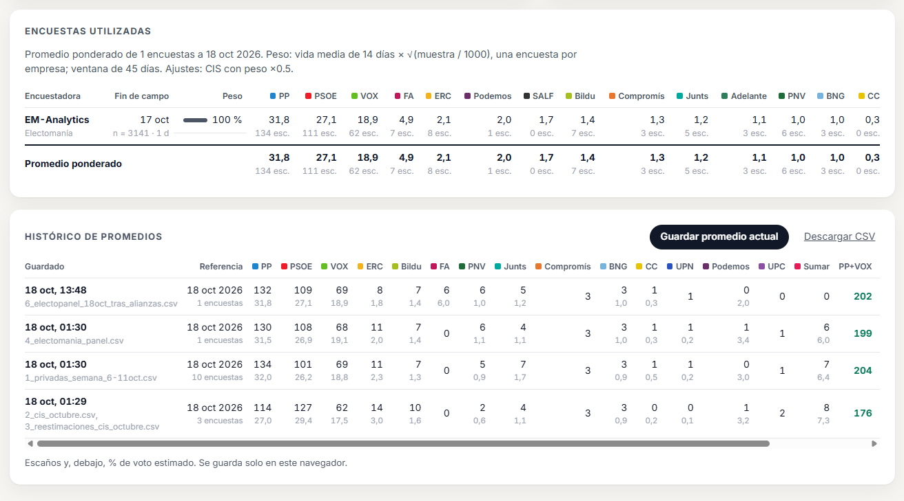
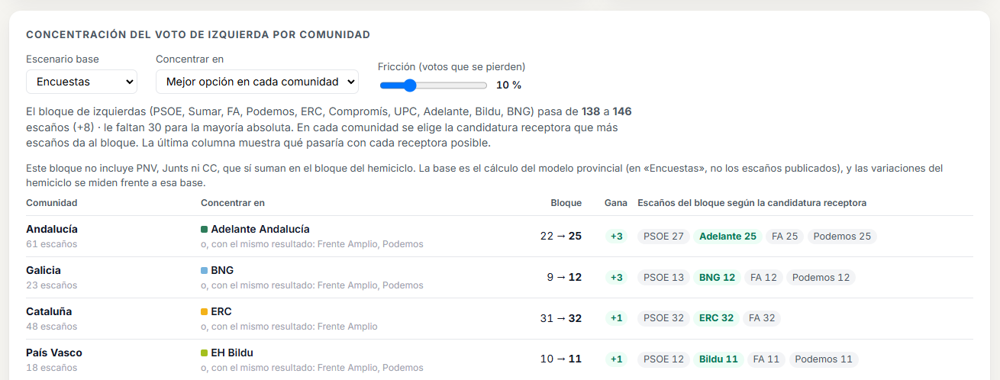

# Simulador electoral 29-N · Congreso de los Diputados

Simulador interactivo del reparto de los 350 escaños del Congreso con el **sistema D'Hondt provincia a provincia**
(barrera del 3 % sobre votos válidos). Incluye mapa provincial, hemiciclo animado, carga de encuestas en CSV con
promedio ponderado y una simulación de «voto útil» para la izquierda, con las alianzas electorales del 29-N.

> **Aviso sobre los datos.** Los escaños por provincia son los oficiales. El censo y los perfiles de voto por
> provincia son **aproximaciones** para modelizar, no datos oficiales, y los escenarios de 2026 son **simulaciones**.
> No uses los resultados como predicción sin contrastarlos. Fuentes oficiales: [infoelectoral.interior.gob.es](https://infoelectoral.interior.gob.es).

## Qué hace



*Pestaña «Resultados 23J»: mapa por provincia (la intensidad del color indica el % del ganador) y hemiciclo con
la barra de 176 escaños, los bloques y la variación de cada partido respecto a la pestaña anterior.*

| Pestaña | Contenido |
|---|---|
| **Resultados 23J** | Modelo de las generales de 2023 (asigna mal 4 escaños frente al resultado oficial). |
| **Alianzas 2026** | Escenario hipotético de 2026 con los acuerdos territoriales del 29-N. |
| **Sim: Frente Unido** | Toda la izquierda alternativa en una lista, con una bonificación por unidad calibrada con 40dB. |
| **Encuestas** | Carga uno o varios CSV, pondera las encuestas, calibra cada candidatura y aplica el resultado al mapa. Muestra los escaños que publica la encuesta o los del modelo, y guarda un histórico de promedios. |
| **Voto útil** | En cada comunidad, concentra el voto de la izquierda alternativa en la candidatura que más escaños da al bloque, o en un partido concreto (PSOE incluido). |

En todas: tooltip por provincia con el voto, los escaños, quién se llevó el último escaño y los votos que le
faltaron al siguiente partido.

## Puesta en marcha

Requisitos: **Node.js 18 o superior** (recomendado 20 LTS o superior) y npm.

```bash
npm install
```

```bash
npm run dev
```

La web se abre en `http://localhost:5173`.

| Script | Para qué sirve |
|---|---|
| `npm run dev` | Servidor de desarrollo con recarga automática. |
| `npm run build` | Genera la web estática en `dist/` (Vercel y Netlify la detectan sin configurar nada). |
| `npm run preview` | Sirve `dist/` en local para revisarla antes de publicar. |
| `npm run verificar` | Comprueba el motor sin navegador: un caso de D'Hondt de manual, que las provincias sumen 350 escaños, que cada escenario reparta 350, que la calibración reproduzca las encuestas y que el voto útil nunca empeore al bloque. **Ejecútalo antes de cada pull request.** |
| `npm run agregar` | Calcula desde la terminal el promedio de `data/encuestas.csv` (lo usa `verificar`). |

En Windows, si PowerShell bloquea `npm` («la ejecución de scripts está deshabilitada»), usa `npm.cmd` en su lugar.

## Estructura

```
index.html                  Maquetación
src/main.js                 Orquestación: calcula escenarios y conecta la interfaz
src/styles.css              Estilos (variables CSS, sin frameworks)

src/lib/                    Lógica pura, sin DOM (se puede probar en Node)
  dhondt.js                 Reparto D'Hondt: barrera, desempates, último escaño
  datos.js                  Votos por provincia: perfiles, swing, partidos regionales, geografía, coaliciones, calibración
  encuestas.js              Lectura de CSV, ponderación de encuestas, promedio de escaños publicados
  concentracion.js          Simulación de voto útil por comunidad

src/ui/                     Componentes de la interfaz
  mapa.js · hemiciclo.js · tooltip.js · leyenda.js
  cargaEncuestas.js         Carga de CSV (botón y arrastrar), ponderación, almacenamiento local
  panelEncuestas.js         Tabla de encuestas usadas
  historico.js              Histórico de promedios (guardar, cargar, exportar CSV)
  panelConcentracion.js     Controles y tabla del voto útil
  formato.js                Formato de números y catálogo de partidos

src/data/                   Datos del modelo (JSON, editables)
  provincias.json           Código INE, escaños, censo aproximado y ajustes por provincia
  partidos.json             Colores, orden en el hemiciclo, nombres cortos, ámbito de los partidos regionales
  escenarios.json           Parámetros, perfiles autonómicos, escenarios, alianzas del 29-N, voto útil, bloques
  geografia.json            Corrección geográfica del swing (VOX) con autonómicas recientes
  ccaa.json                 Nombres de las comunidades

data/                       Datos de entrada de encuestas
  encuestas.csv             CSV de ejemplo (encuestas FICTICIAS) que se carga por defecto
  agregacion.json           Valores por defecto de la ponderación
  encuestas_reales/         Encuestas reales en CSV y FUENTES.md con su origen

scripts/
  verificar.mjs             Pruebas del motor
  agregar.mjs               Promedio de encuestas en la terminal

docs/img/                   Capturas usadas en este README
```

## Cómo funciona el modelo

1. **Base 2023.** Votos por provincia = censo × participación × (1 − nulos) × cuota de cada partido. La cuota
   sale del perfil de su comunidad (`perfiles`) más el ajuste de la provincia (`ajustes`).
2. **Swing proporcional** para 2026: cada partido se multiplica por un factor nacional (`factores`), se reparten
   los votos de partidos que se dividen (`transferencias`, p. ej. Sumar → Frente Amplio + Podemos) y se añaden
   partidos nuevos (`nuevos`, p. ej. SALF).
3. **Partidos regionales** (`ambito` en `partidos.json`, p. ej. Adelante Andalucía): su voto nacional se reparte solo
   en su comunidad, y entre sus provincias según `perfilProvincial` (autonómicas andaluzas de 2026).
4. **Geografía** (`geografia.json`): el crecimiento de VOX se reparte entre provincias según las autonómicas
   recientes, sin cambiar su total nacional.
5. **Coaliciones y alianzas**: los miembros suman sus votos bajo una `marca`, solo en su `ambito` si lo tiene. Una
   `friccion` positiva son votos que se pierden; una negativa es una bonificación por unidad, y `traspasos` indica
   de qué partidos sale. Los acuerdos del 29-N están en `alianzas.29N`:
   - **Cataluña:** ERC con Podemos (Frente Amplio va aparte).
   - **Comunidad Valenciana:** Compromís-Front Valencià (Compromís, EU, Podem y ERPV).
   - **Canarias:** Unidad del Pueblo Canario (Podemos, Nueva Canaria e IU).
   - **Resto:** Frente Amplio y Podemos por separado; Bildu, BNG y Adelante Andalucía en solitario.
6. **Calibración con encuestas** (pestaña Encuestas): las encuestas dan el voto de cada candidatura tal como se
   presenta (el % de Podemos es solo donde va en solitario, ERC es ERC-Podemos…). El modelo simula con las
   alianzas y ajusta los factores hasta que el voto nacional de cada candidatura coincide con la encuesta.
7. **D'Hondt** en cada provincia. El total nacional es la suma de las provincias.

Todos los supuestos están en `src/data/*.json`, con la fuente indicada en los campos `_nota`, `_fuente` y
`_calibracion`.

## Encuestas

### Formato del CSV

Una fila por encuesta. Se aceptan separadores `,` o `;` (el formato de Excel en español) y decimales con punto o coma.

| Columna | Obligatoria | Contenido |
|---|---|---|
| `encuestadora` | Sí | Nombre de la empresa. |
| `medio` | No | Medio que la publica. |
| `inicio_campo`, `fin_campo` | `fin_campo` sí | Fechas `AAAA-MM-DD`. |
| `muestra` | Sí | Número de entrevistas. |
| `PP`, `PSOE`, `VOX`, `FA`… | — | % de **estimación de voto** de cada candidatura, con el id de `partidos.json`. Una celda vacía significa que esa encuesta no midió al partido. |
| `PP_esc`, `PSOE_esc`… | No | Escaños que publica la encuestadora. Admite horquillas (`135/137`). |
| `notas` | No | Texto libre (se ignora). |

Ejemplo: [`data/encuestas_reales/6_electopanel_18oct_tras_alianzas.csv`](data/encuestas_reales/6_electopanel_18oct_tras_alianzas.csv).

### Carga y ponderación



Pulsa «Cargar CSV de encuestas» o arrastra uno o varios archivos a la página. Peso de cada encuesta =
0,5^(días / vida media) × √(muestra / 1000) × peso de la encuestadora. Por defecto se usa una sola encuesta por
empresa (la más reciente), dentro de una ventana de 45 días. Todo es configurable en la web (sección
«Ponderación») y en `data/agregacion.json`, CIS incluido (excluirlo o darle otro peso). Los archivos cargados se
guardan en el navegador.

### Encuestas utilizadas e histórico



La tabla muestra cada encuesta con su peso, su % de voto y, debajo, los escaños que publica. El hemiciclo puede
mostrar esos escaños publicados («Según la encuesta») o el cálculo del modelo («Modelo provincial»). El
**histórico** guarda cada promedio con sus archivos y su ponderación: se puede volver a cargar exactamente igual,
borrar o descargar en CSV.

## Voto útil



Para cada comunidad, prueba cada candidatura de la izquierda como receptora: el voto del resto pasa a ella, menos
una fricción (votantes que no siguen la consigna) que es configurable, y se recalcula D'Hondt. El selector
«Concentrar en» permite:

- **Mejor opción en cada comunidad**, con o sin el PSOE como posible receptor.
- **Siempre en un partido concreto**, solo entre los que concurren en el escenario base.

La tabla muestra los empates y lo que daría cada receptora posible. Es un **máximo teórico**: supone que el voto
se traslada en bloque.

## Datos y fuentes

| Dato | Fuente | Estado |
|---|---|---|
| Escaños por provincia | Reparto oficial de 2023 (suma 350) | Oficial |
| Censo por provincia | Valores redondeados del censo de residentes | **Aproximado** |
| Perfiles de voto 2023 | Aproximación a los resultados del 23J por comunidad | **Aproximado** |
| Alianzas 29-N | El País, 16/10/2026 | Contrastado |
| Adelante Andalucía por provincia | Autonómicas andaluzas 17/05/2026 (Junta Electoral de Andalucía, vía Wikipedia) | Oficial |
| VOX por provincia | Autonómicas 2023–2026 (vía Wikipedia) | Oficial |
| Bonificación por unidad | 40dB para EL PAÍS/SER, 7-8/10/2026 | Contrastado |
| Encuestas reales | Wikipedia y publicaciones originales (ver `data/encuestas_reales/FUENTES.md`) | Revisar cada cifra |

## Limitaciones conocidas

- El censo y los perfiles provinciales son aproximados: algunas provincias salen casi idénticas (p. ej. Lugo y Ourense).
- Las encuestas de antes del 16/10/2026 medían a Podemos como lista estatal; con la calibración se interpretan
  como «donde va en solitario».
- La bonificación del Frente Unido se midió solo para FA + Podemos; extenderla a ERC, Compromís-FV y UPC es una
  extrapolación.
- Drago Canarias, Teruel Existe y otros partidos pequeños no se modelan.
- El mapa siempre muestra el modelo provincial: las encuestas no publican escaños por provincia.

## Cómo colaborar

Las contribuciones son bienvenidas, sobre todo:

- **Encuestas nuevas** en CSV, con su fuente en `data/encuestas_reales/FUENTES.md` y, si existen, sus escaños publicados.
- **Datos oficiales** que sustituyan a las aproximaciones: censo por provincia, resultados de 2023 por provincia.
- **Perfiles provinciales** de partidos regionales o de la geografía de otros partidos (`geografia.json`).
- **Cambios en las alianzas** si se cierran acuerdos nuevos (`alianzas` en `escenarios.json`), citando la fuente.
- Mejoras de la interfaz, de la accesibilidad o del rendimiento.

### Flujo de trabajo

1. Haz un fork y crea una rama con un nombre descriptivo (`encuestas/cis-noviembre`, `datos/censo-ine`, `fix/tooltip-movil`).
2. `npm install` y `npm run dev` para trabajar en local.
3. Antes de abrir el pull request:
   - `npm run verificar` debe terminar con «Todo correcto».
   - `npm run build` debe compilar sin errores.
   - Revisa en el navegador la pestaña que hayas tocado, sin errores en la consola.
4. Abre el pull request explicando **qué cambia, por qué y de dónde salen los datos**.

### Convenciones

- **Idioma:** código, comentarios y textos en español.
- **Lógica en `src/lib/`:** debe ser pura (sin DOM), para poder probarla en Node desde `scripts/verificar.mjs`.
  Si añades lógica de cálculo, añade también una comprobación allí.
- **Datos con fuente:** cualquier cifra que no sea oficial se marca como aproximada y se documenta en el JSON (`_nota`, `_fuente`).
- **Sin inventar datos:** si una encuesta no publica un partido, su celda va vacía, no estimada.
- **Dependencias:** no añadas dependencias nuevas sin comentarlo antes en un issue. El proyecto usa solo D3,
  topojson, es-atlas y d3-composite-projections.
- **Estilo:** sigue el del código existente (módulos ES, funciones pequeñas, nombres descriptivos en español).

## Licencia

[MIT](LICENSE).
